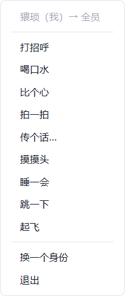
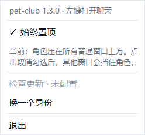
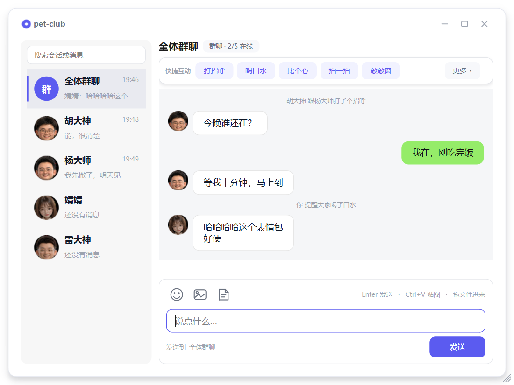
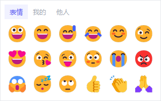
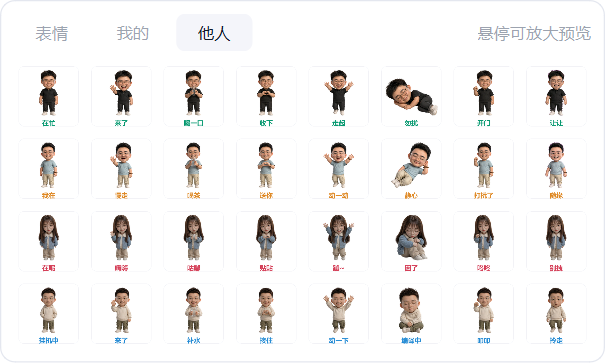
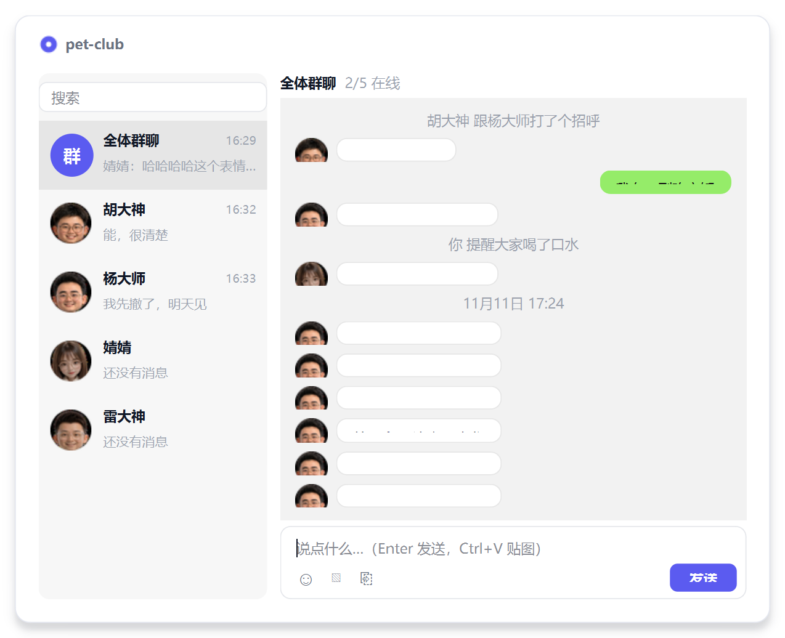

# pet-club

多人桌面宠物。一台服务器就是一个房间，**没有房间码** ——
连上同一台服务器，认领一个身份，你的角色就会出现在所有人的桌面上。

- 六个身份（猥琐 / 胡大神 / 杨大师 / 婧婧 / 雷大神 / 左大神），**认领后不能重复认领**，由服务端裁决
- 服务器地址写死在 `petclub/config.py`，客户端不接受任何配置
- **打开就是全部**：直连内置服务器 `47.94.21.34:8765`，只挑一个身份，没有地址要填
- 桌面上常驻「这台服务器上所有被认领的角色」；别人认领时，他的角色**从天而降**
- 互动全在右键菜单里：**右键谁，就是对谁**
- 角色可以**按住拖动**，松手会掉回地面 —— 纯本地效果，别人看不到
- 每个身份**一套自己的台词**，同一句提醒在两边、在两个人身上说法都不一样
- 桌面上除了角色本身**没有任何常驻控件**，不占地方也不碍眼
- **托盘图标**是唯一的常驻入口：有未读时闪红点，左键直接落到那条消息，右键有图层、检查更新、退出
- 一台电脑**只跑一个**：再点一次不会开第二个，第二个进程安静退出
- 界面用 Qt（PySide6）自己画，没有任何网页壳；图片处理只用 Pillow

## 目录

```
pet-club/
├─ server.py            服务端（纯标准库单文件，可本地跑也可部署到公网）
├─ run.py               客户端入口
├─ petclub/             客户端
│   ├─ host.py          平台收口：屏幕、前台、层级、字体、数据目录（界面只问它）
│   ├─ win32.py         Windows 实现：工作区 / 前台窗口 / z 序 / 点命中测试
│   ├─ macos.py         macOS 实现：NSWindow 层级、CGWindowList 遮挡判定（PyObjC，可缺）
│   ├─ windows.py       角色窗口与气泡（逐像素透明 + 按 alpha 的点击穿透）
│   ├─ theme.py         配色、全局样式表、卡片窗、按钮、圆头像
│   ├─ net.py           网络层（子线程收发 + 队列投递给主线程）
│   ├─ sprites.py       素材加载与循环帧对齐
│   ├─ actors.py        桌面上的角色（天降出场 / 待机动作 / 抓起与掉落）
│   ├─ actions.py       动作目录 + 三套台词（加玩法只改这里）
│   ├─ single.py        单实例锁（一台电脑只跑一个，第二个安静退出）
│   ├─ chat.py          聊天面板（群聊 + 每人一个单聊，文字/图片/表情/表情包/文件）
│   ├─ claim.py         认领身份的五张卡片
│   ├─ media.py         图片压缩编码、缩略图缓存、文件与表情包路径（纯 PIL，不碰 Qt）
│   ├─ tray.py          托盘图标（QSystemTrayIcon）+ 菜单铺设
│   ├─ update.py        自动更新（拉清单 → 下载校验 → 换 exe）
│   └─ app.py           主程序：网络、动作、聊天记录、更新、窗口生命周期
├─ assets/roles/        六个角色的素材（p1~p6 × 11 个姿势）
├─ assets/stickers/     角色表情包（tools/make_stickers.py 生成）
├─ assets/app.ico       exe 图标（由 tools/make_icon.py 生成）
├─ assets/app.icns      .app 图标（由 tools/make_mac_icons.py 生成）
├─ docs/多人互动设计.md  多人架构、协议、分期
├─ docs/互动玩法设计.md  互动玩法（全指令跨端、无冷却、台词、集合、指标）
├─ docs/部署服务端.md    局域网 / 云服务器 / 内网穿透三种部署方式
├─ docs/自动更新.md      腾讯云 COS 发版与客户端升级流程
└─ tools/               自测、探针与打包脚本
```

## 跑起来

### 1. 起客户端

```bash
python run.py
```

也可以直接双击 `启动桌面端.bat`（有这个 bat 会自动优先用打好的 exe），
或者直接双击 `dist\pet-club.exe`。**没有参数、没有配置文件** —— 打开就直接连
`47.94.21.34:8765`（写死在 `petclub/config.py`）。连不上会一直重试，并且
把「连不上服务器，正在重试」说在当下唯一亮着的窗口上：还没认领身份时是
认领窗那行小字，已经在桌面上时是角色头顶的气泡（界面上不写地址）。

**一台电脑只能跑一个**：再点一次图标不会开第二个窗口，第二个进程直接安静退出
（退出码 0）。两个实例会抢同一个身份、互相把对方顶下线，还会在桌面上留下两套
影子角色，所以这条是硬约束。实现见 `petclub/single.py`（Windows 用命名互斥体，
进程一死系统自动回收，不会留下「上次没退干净就再也起不来」的锁文件）。

### 2. 认领身份

连上后是「认领一个身份」：六个角色的 `wave.png` 立绘直接摆出来挑，
**已经被别人认领的会变灰、点不动**。选一个空着的，点「认领这个身份」。


身份不能重复认领：如果两个人同时抢同一个，服务端判定先到的赢，
输的那位会带着最新占用情况重新弹出认领窗。

## 桌面上会发生什么

- **只显示已认领的角色**。没人认领的身份不会出现在桌面上（也不会显示占位）。
- 自己认领成功 → 自己的角色从天而降，落地后说一句「我是 XX，到位啦～」。
- 别人认领 → 他的角色**在所有人的桌面上**从天而降。
- 有人离开 / 掉线 → 他的角色从桌面上消失，身份重新变成可认领。
- 左键点自己的角色 → 摸摸头（睡着时点它是叫醒）。
- **按住任意角色拖动 → 抓起来挪走，松手会掉回地面**。这是纯本地效果：只挪你自己屏幕上的窗口。
- **右键别人 → 只对他**，**右键自己 → 对全员**，两边菜单里的动作完全一样。
- 桌面上没有别的控件：没有角落圆点、没有悬浮按钮、没有常驻状态条 ——
  除了角色本身，一个像素都不多占。托盘图标在任务栏里，不在桌面上。

### 角色多大

素材是物理像素。Qt 按屏幕缩放（dpr）换算，1 个素材像素恒等于 1 个屏幕物理
像素，所以角色的屏幕宽度不随系统缩放变化；旧 Tk 版把素材像素当**逻辑**像素
交给窗口管理器，175% 缩放下被系统又乘了一次 —— 等效放大 1.75 倍，看起来
大一圈。换算本身是自洽的，不是 bug，所以 `config.PET_SCALE` 给一个**显式的
观感系数**：

| 值 | 效果 |
| --- | --- |
| `0`（默认） | 跟随当前屏幕 dpr，复现旧版观感 |
| `1.0` | 一比一，按素材物理像素显示（Qt 版原样） |
| `1.75` | 固定放大 1.75 倍 |

只放大绘制、蒙版和命中区域；脚底中心、地面、拖动、服务端坐标仍是物理像素，
协议一行都不用改。气泡锚点按放大后的身高抬上去，角色头顶那句话始终跟着人。

## 互动玩法

**右键谁，就是对谁** —— 目标由「点哪只宠物」决定，菜单里只有动作，不用先选人。

```text
右键别人的角色                右键自己的角色
┌──────────────────┐   ┌──────────────────┐
│ 胡大神 → 只对他    │   │ 猥琐（我）→ 全员   │
├──────────────────┤   ├──────────────────┤
│ 打招呼            │   │ 打招呼            │
│ 喝口水            │   │ 喝口水            │
│ 比个心            │   │ 比个心            │
│ 拍一拍            │   │ 拍一拍            │
│ 传个话…           │   │ 传个话…           │
│ 摸摸头            │   │ 摸摸头            │
│ 睡一会            │   │ 睡一会            │
│ 跳一下            │   │ 跳一下            │
│ 起飞              │   │ 起飞              │
│ 集合              │   │ 集合              │
├──────────────────┤   ├──────────────────┤
│（右键别人只到这儿） │   │ 换一个身份 / 退出   │
└──────────────────┘   └──────────────────┘
```

菜单出现的位置**不会盖住角色**：右键的那一刻鼠标正点在角色身上，所以菜单会
自动挪到角色的左边或右边（贴边时换另一侧），而不是照着鼠标位置糊下去。



**菜单一模一样**，唯一的区别是第一行灰字写「→ 只对他」还是「→ 全员」。

**十条指令每一条都会出门。** 右键别人，对方屏幕上他自己做那个动作；右键自己
（或点菜单里的「→ 全员」），指令发给全屋，谁开着客户端谁就看得见。

区别只在「谁在演」：

| 指令 | 我 | 他 |
|---|---|---|
| 打招呼 / 喝口水 / 比个心 | 我做 | 他跟着做 |
| 拍一拍 / 摸摸头 | 我伸手 | 他跳一下 |
| 传个话 | 我发一句 | 他不动（单向） |
| 睡一会 / 跳一下 | 我做 | 他跟着做 |
| 起飞 | 我升空再掉下来 | 他也升空再掉下来 |
| 集合 | 我招手喊一声 | 别人爬过来靠拢 |

「一起玩」的规则看目标：**右键自己 = 广播给全员，一屋子人一起做** ——
你提醒大家喝水，五块屏幕上都是所有在场角色端着杯子；**右键某个人 = 只有你和他**，
别人站着。每个客户端自己演，但演的是同一件事，所以站谁的屏幕前看到的都一样。

**「集合」是唯一一条改变位置的指令。** 发起者招手喊一声，其余角色用
`crawl_1 / crawl_2` 两帧爬到他身边站定：按当前站位分左右排开，离得最近的
站最里，谁也不叠在发起人或彼此身上；点名时只有被点到的那位爬过去。角色
现在可以摆在桌面任意高度，集合会连高度一起靠拢。位置本来就是**本机**的（见下），
所以每台机器各自按自己屏幕上的站位算落点，服务端一个字段都不用加 —— 谁的
屏幕上都是「大家向发起人靠拢」，只是各人先前把角色摆在哪儿不一样。

气泡只冒两处：发起的那句话，和收到广播的**你自己**那句回应。桌上第三个角色
会跟着动，但不替它说话。传个话这类单向动作只让对方看一眼。

**只有「点一下自己」是本机的**：点自己那只（没在睡）就是摸一下自己的头，
不发消息 —— 手滑点一下不该让六个人的屏幕都跟着跳。菜单里的「摸摸头」才传出去。

**台词按身份写**（`VOICE`）：猥琐说「喝口水啊兄弟」，胡大神说「喝水」，
婧婧说「别忙了，润润嗓子吧」，
杨大师说「记得饮一杯温水」；对方回的那句也是各自的口吻，不是同一句复制两遍。

**没有冷却。** 点得动就是真的做了，没有秒数、没有置灰、没有「还要等 2 秒」。
连点就是连点：每个角色只有一个姿势和一条计时器，后一个动作直接顶掉前一个
（`actors.Pet.act`），不存在两个动作交错，也不用排队。

聊天记录里**只有 `TIP` 里有文案的指令才留痕**（打招呼 / 喝水 / 比心 / 拍一拍 /
摸头 / 起飞 / 集合）—— 睡一会、跳一下是环境动作，动了就动了，不在群里报一遍。
留痕只有这一个开关，`ACTIONS` 里不另写标记：两处声明迟早会有一边漏改。

## 托盘

关掉认领窗、关掉聊天面板之后程序还在跑 —— 那时候唯一点得到它的地方就是托盘。

| 动作 | 结果 |
|---|---|
| **左键**单击图标 | 打开聊天面板；有未读就**落在最新那条所在的会话**上，没有就停在全体群聊 |
| **右键**单击图标 | 菜单：打开聊天 / 始终置顶 / 同步远程互动 / 检查更新 / 换一个身份 / 退出 |

跟「软件本身」有关的事都在右键菜单里，宠物的右键菜单只管**对角色下指令**。
没认领身份时点左键会先把认领窗叫出来（聊天窗要挂在身份上：头像、台词、单聊列表都靠它）。

**有未读时图标会闪**：原图标和右上角带红点的 `assets/app_alert.ico` 每 0.7 秒换一次，
悬停提示同时写「N 条未读」。读完（切到那个会话）就立刻停在高亮那一拍并换回原图 ——
不会让人盯着一个红点猜是不是还有。

哪些算未读，写在一个地方（`App._store`，所有聊天记录的唯一入口）：

- 别人说的**话**（含图片、表情、文件）算；
- 自己发的不算；
- 「拍了拍你」这类**动作痕迹**不算 —— 桌宠本来就会播动画，为点一下头闪图标太吵；
- 正看着那个会话（面板开着且选中的就是它）不算。

未读是 `App.unread` 一份数据，聊天面板的红点直接画它 —— 两边各存一份就会出现
「红点清了、图标还在闪」。

**两个开关**都是菜单里的可勾选项：

```text
打开聊天
─────────────
✓ 始终置顶        ← 勾着 / 不勾，鼠标停上去才展开解释
✓ 同步远程互动
─────────────
检查更新
换一个身份
─────────────
退出
```



菜单里不放整行说明文字：QMenu 会按最长那一行把整个菜单撑宽、还不会折行。
所以「现在是什么状态、点了会怎样」收进这一项的 tooltip，版本号只留在托盘悬停提示里。

- 勾着（默认）= 角色始终压在其他窗口上方 —— 桌宠本来就应该这样；
- 不勾 = 和普通窗口同级，会被浏览器、资源管理器挡住 ——
  要往别的窗口里拖文件、而角色正好站在那儿时，就靠它让路；
- **只作用于「人物」那一层**（角色和它们的气泡）。认领窗、右键菜单、预览大图这种弹层永远置顶。
- **聊天面板**只在自己是前台窗口时置顶：用户在微信里打字，面板就退回普通层让位
  （以前是「永远置顶」，结果点了微信也翻不上来）；点回面板立刻又插回置顶带。
  但面板压到角色身上时，角色会被顶回面板之上 —— 「始终置顶」是对角色说的，自家面板也不例外；
  角色挡住正文时把它拖开就行，拖走后不会自动跑回来。表情浮层跟着面板一起收。

**「同步远程互动」管的是收到的那一侧**：勾着（默认）时别人发来的指令会在你桌面上演
一遍；取消勾选后他的角色一动不动，只有聊天记录里仍留一条「胡大神 提醒大家喝水」——
不然对方以为没发出去，你事后也说不清刚才为什么没反应。自己发出去的指令、别人发来的
聊天消息都不受影响，关的只是「被别人的动作打断」。选择写进 `prefs.json`
（`remote_actions`），重启后还是这个状态。

**同一个开关有两个入口**：托盘右键，或聊天窗左下角「我是谁」那条点开的菜单
（人坐在聊天窗里时不用再去托盘找）。两边读写的都是 `App.remote_on` 这一份状态，
在哪边切都一样。

**「始终置顶」靠巡检维持**，不是设一次就完事。Windows 的置顶是一整条共享的带子，
谁最后被激活谁排前面 —— 浏览器、资源管理器、任何自己置顶的程序一被激活就会插到
角色前面，之后再没人把角色放回去。所以主循环里有个巡检：切了前台窗口就立刻查一次，
平时每 3 秒兜底一次，拿角色身上一个不透明像素做命中测试，确认被别人的程序、或者
**自家聊天面板**压住了才重新插队（菜单、预览大图、头顶气泡这些自家弹层不动手，
它们本来就该压在角色上面）。聊天面板刚被激活时马上插一次，不等 3 秒兜底。
同一趟巡检里还要把聊天面板的层级跟着前台走（`ChatWindow.follow`）——
**角色压在面板之上、面板压在其他程序之上**，这是两件事。

托盘用 Qt 自己的 `QSystemTrayIcon`，**没有引入 pystray 之类的依赖**：
它还要自己维护一个隐藏窗口收消息，而 Qt 这层已经给了。
托盘只管收点击（`Trigger` = 左键、`Context` = 右键），开什么窗是 `app.py` 的事。

> 托盘图标只在 Windows 上有意义。`PETCLUB_NO_TRAY=1` 可以让探针不挂它
> （一次跑好几个 App，右下角会闪个不停）。

## 聊天面板

「传个话…」打开的是一个**按微信 PC 版结构排的面板**：整个窗口是一块
12px 圆角的外框，**顶部标题带和左侧会话栏共用同一个底色**，中间不画分隔线，
看上去连成一整块；右边是一块白色会话平面（会话标题 / 消息流 / 输入区），
左上角一个圆角，靠色差和左栏分开。搜索框下面就是会话列表（头像、名字和
时间同一行、下面一行最后一句、未读红点，选中行是一枚白色圆角胶囊），
不再有「发起会话」加号 —— 会话是固定的几个，加号只是多一次点击。
一个人有**四个会话** —— 一个「全体群聊」，加上我以外每个人的单聊。

会话标题右边是一枚**浅灰胶囊**（「1/5 在线」「在线」「空闲」）：状态只靠
左边那颗小圆点区分，绿点在线、灰点空闲。以前是绿底绿字的标签，压在白平面上
和整套界面对不上 —— 状态该是「一眼看到」，不是「一块颜色」。

> 窗口本身**不是半透明窗口**。Windows 上的半透明无边框窗是一条「分层窗口」，
> 一最小化，任务栏缩略图就渲染成一块残缺的色块 —— 圆角改由系统裁（Win11 的
> DWM），窗口保持不透明，缩略图才是整张界面。Win10 上系统不支持，退化成直角。



### 窗口与快捷互动


- **右上角三颗按钮**：最小化、最大化/还原、关闭。三个都只动窗口 ——
  最小化收进任务栏，关闭只是把面板藏起来，**进程继续留在托盘**；
  退出程序走托盘菜单或左下角头像菜单里的「退出」。关窗期间来的消息照常计未读、
  闪红点，再点托盘会复用同一个面板（草稿和历史都还在）。
- **左下角那条「我是谁」点得动**：点一下弹出「桌宠大小 / 同步远程互动 / 换一个身份 / 退出」。
  **桌宠大小**分小 / 默认 / 大三档，选完写进本机的 `prefs.json`，角色按新尺寸
  重新落一次（窗口尺寸、位图和命中区都是一次性算好的，重建最稳）。
  换身份会释放当前身份、收起面板，再弹认领窗 —— 不用回桌面右键找角色。
  以前这几件事只藏在角色的右键菜单里，人坐在聊天窗里时谁也想不起来去那儿找。
- **窗口能拉大拉小**：拖四条边或右下角的斜纹把手，最小 680×470；
  最大化时贴边铺满。
- **快捷互动在输入卡片的最上面一排**：不再是浮在消息画布上的透明按钮，
  而是一排白底描边的小药丸，和输入框同属一张浅灰卡片。不用回桌面找角色右键，
  点一下「打招呼 / 喝口水 / 比个心…」就发。目标跟着当前会话走 ——
  群聊对全员，单聊只对他。
  这一排**没有「传个话…」**：人已经站在聊天窗里了，再给一个「打开聊天窗」
  的按钮是多余的（右键菜单里留着它，那是从桌面一句话开聊的入口）。
- **放不下就换行，不藏起来**。药丸是 7pt / 22px 高的紧凑尺寸，宽窗口一行摆完；
  窄到放不下就分成两行（最多两行），不再有「更多」那种二级浮层 —— 藏在浮层里
  的按钮，点之前谁也不知道里面有什么。
- **消息永远停在最新一条**：输入框里敲多行、窗口拉高拉矮、自己刚发出去一条，
  消息区都会贴回底部。只有手动往上翻看历史时才不跟着动。

- **群发的进群聊，点名的进那个人的单聊**。以前只有一个窗口，对全员和对某个人
  混在一条时间线上，聊几句就分不清哪句是跟谁说的了。
- **互动会留下记录**。请求起飞、提醒喝水、比心、拍一拍以前只冒一个 2.6 秒的气泡，
  飘完就没痕迹；现在它们作为**居中的灰色系统提示**落在对应的会话里
  （「猥琐 请求起飞」「你 跟杨大师打了个招呼」），和微信里
  「谁 拍了拍你」是一个东西 —— 是记录，不是消息，所以不占气泡、不带头像。
- **能随便切**：点左边任意一行就换会话，发送目标和快捷互动都跟着当前会话走；
  不在当前会话的新消息会在那一行挂一个红色未读数。
- **搜索框是真能用的**：输入「喝水」会把说过这句话的会话筛出来。
- **发不出去的会说出来**：对方没在线写「「杨大师」不在线，这句发不出去」
  ——不会静默丢掉。

### 图片、表情、文件

输入区是右侧平面最下面的一张**浅灰圆角卡片**：最上面一排是快捷互动，
下面是几行高的文本框（Enter 发送、Shift+Enter 换行），最底下一行左侧是两颗
矢量自绘图标 —— **表情**、**图片 / 文件**，中间写着发送目标，右下是「发送」按钮。
图标悬停会放大并浮出底色，整体字号比消息气泡更紧凑。





- **文件和图片是一颗按钮、一次选择**：点一下直接开系统文件框（就是资源管理器
  那个窗口），不先弹「发送图片 / 发送文件」两个选项 —— 看扩展名就知道是什么，
  多一次点击只是拦路。选中的图片和文件**不会立刻发出去**，而是变成一张张
  可删除的小卡片落在输入框上方；配好文字、确认没选错，再一起点发送，和微信一样。
- **表情和表情包都能悬停放大**：鼠标停在一格上会弹出 200px 的大图预览。
  预览位图按 2x 物理像素生成并标上 DPR，贴纸从 256px 原图直接缩放，
  不再把 48px 的格子缩略图拉大 —— 高分屏上是 1:1，不会糊成一团。
- **表情**用系统自带的彩色 emoji 字体（Windows `Segoe UI Emoji`、
  macOS `Apple Color Emoji`），字符只传那一个字节。
  发的时候只传那个字符，对面用自己机器上的字体渲同一张脸 ——
  Qt 走 DirectWrite / CoreText，彩色字形直接画得出来，不用我们再渲染位图。
- **表情页第一格可以放一张自己的贴图**（默认空着）：微信那只狗头不是 Unicode
  字符，Unicode 里也没有对应码位，只能是一张图。约定放在
  `assets/emoji/doge.png`（正方形，边长 96 的整数倍）—— **有就自动占第一格**、
  走贴图通道发原图，聊天里比 emoji 字符大一圈、不带气泡底；**没有就不排这一格**，
  不会留个空格子。换图直接覆盖文件，不用改代码。
- **表情包**是六个角色各自的八张卡片（`tools/make_stickers.py` 用姿势图 + 一句话生成）。
  分三页放：`表情` 是通用反应，`我的` 是我自己那张脸，`他人` 是另外五个角色的 40 张
  —— 想替别人演一下、或者单纯觉得那张图好笑，都能直接发（发出去就是一张图片）。
  三页都是 **8 列，行数跟着内容走**：换页时面板自己收放，`我的`（八张一行）
  不会撑在三行的高度里、把格子挤到底边裁掉。
- **图片**发之前在本地缩到 1280px 长边、重新编码（上限 1.2MB，超了继续缩），
  气泡里最多 240px（表情包 160px）。**点一下看原图**：预览窗置顶在聊天窗和
  桌宠之上，滚轮缩放（1×~6×）、按住拖动、单击 / Esc 关掉 —— 不再拿 240px 的
  缩略图硬放大。自己刚发的那张优先读本地原文件，比编码后的副本更清楚。
- **Ctrl+V 直接贴**：剪贴板里是截图 / 复制的图片 / 资源管理器里复制的文件，
  在面板里按一下就先落进输入框（一次最多 3 个），和选文件是同一条待发的路。
  剪贴板里是纯文字时，Ctrl+V 还是原本那个「粘贴文字」——不抢。
  截完图不用先存成文件，这是这条路的全部意义。
- **文件**原样传，上限 2MB。收到的文件落在
  `%LOCALAPPDATA%\pet-club\files\`（源码模式是 `petclub-data/files/`），
  卡片上点一下就调系统默认程序打开。文件名里带 `../` 之类的会被吃掉，不会写出目录。

记录只存在内存里（本次运行内，每个会话最多 50 条），关掉面板不会清空，
重新打开还在，并且停在刚才那个会话。

面板默认 860×620、开在**屏幕正中**，不是模态的 —— 说话的时候角色照常能拖、能动。



> 服务端会给每条互动带上 `to` 字段，客户端靠它区分「对大家说的」和「专门对我说的」。
> 老服务端没有这个字段，新客户端会当成群发处理（宁可记进群聊，也不记错人）——
> 所以**客户端和服务端要一起更新**。

新动作只需要在 `petclub/actions.py` 里加一行 spec + 三行台词 + 一句提示文案
（`TIP`，四种视角各一句），服务端不用动。

设计说明见 [docs/互动玩法设计.md](docs/互动玩法设计.md)。

## 服务器地址：写死的

```python
# petclub/config.py
SERVER_HOST = '47.94.21.34'
SERVER_PORT = 8765
```

改这两行 = 改所有客户端的去处，然后重新打包。除此之外**没有任何入口**：
没有地址输入框、没有「服务器设置」菜单、没有命令行参数、没有环境变量、没有 config.json。

为什么不做成可配：可配的时候每个人都要理解「填谁的 IP」，还要处理填错、
连不上、环境变量盖过配置文件、换地址后老地址还留着 —— 全是纯负担。
一个固定的房间，打开就是进去。

**界面上不出现地址**：没有输入框，也没有任何菜单项写着 `47.94.21.34:8765`。
「谁在线」这件事只在聊天面板里看（右侧标题行的「N/5 在线」、每个人头像旁边有没有
消息）；连没连上不说地址，只说「连不上服务器，正在重试」。地址只进控制台
（`[pet-club] 连不上 47.94.21.34:8765`），方便你自己排查，
别人截图、录屏、发群里都不会漏出去。

自己部署一套服务端（局域网 / 云服务器 / frp）的步骤见
[docs/部署服务端.md](docs/部署服务端.md)，但要让客户端连过去，必须改上面那两行。

## 关于内网穿透 / 公网访问

pet-club 走的是**自定义协议 + 裸 TCP**，不是 HTTP，也不是 WebSocket。
这决定了两件事：

**✅ 能直接填的**
- 局域网直连（`192.168.x.x:8765`）
- 有公网 IP 的云主机（`公网IP:8765`）
- **TCP 层**的隧道，比如 `ngrok tcp 8765` 给出的 `x.tcp.ngrok.io:12345`
- Tailscale / ZeroTier 这类虚拟局域网分配到的 `100.x.x.x`

**❌ 不能填的**
- **VS Code 端口转发**、**GitHub Codespaces 转发**生成的 `https://xxx` 地址。
  官方明确只支持 HTTP/HTTPS 和 VS Code 协议，**不支持 TCP 转发**；
  而我们的服务端也不说 TLS，强行填进去会卡在握手阶段，表现为
  「连不上」或「连上后立刻断开、无限重连」。
  跑 `python tools/probe_protocol.py` 可以看到实证。
  另外这类隧道要求你本机 + VS Code 一直开着、地址 24 小时过期，
  本来也不适合当长期服务端。

要让 `https://` 隧道可用，得给服务端加 WebSocket over TLS（`wss`）——目前没做。
真要走公网，最省心的是买一台最便宜的云主机。

## 自测

```bash
python tools/test_config.py     # 固定地址 + 打包路径：没有任何可配后门（26 项）
python tools/test_server.py     # 服务端逻辑（34 项：身份唯一性、并发抢占、断开释放、事件/附件转发…）
python tools/test_actions.py    # 动作目录 / 台词 / 互动痕迹（33 项，纯逻辑不开窗口）
python tools/test_media.py      # 图片/文件/表情包/可选贴图的编解码与缩略图缓存（33 项）
python tools/test_update.py     # 自动更新：版本号、清单、下载校验、换文件脚本（67 项）
python tools/test_host.py       # 平台分派与退化：字体、图标、数据目录、没有 PyObjC 也不崩（27 项）
python tools/test_lifetime.py   # Qt 对象生命周期：菜单关了引用还在、不 deleteLater、认领窗能退出（24 项）
python tools/test_chat_ui.py    # 聊天窗圆角外框、窗口三按钮、缩放、待发附件、表情预览、头像菜单与远程互动开关、长文字换行与选中配色、贴底滚动（147 项）
python tools/test_pet_scale.py  # 角色显式缩放系数（含小/默认/大三档）、命中区域、气泡定位、起飞物理（40 项）
python tools/test_gather.py    # 集合：靠拢落点、两帧爬行物理、广播/点名收发路由（48 项）
python tools/probe_live.py      # 真 Qt 窗口 + 真服务器（本地）的端到端探针（141 项：
                                #   认领与天降、别人加入/离开、互动与镜像、集合爬行、菜单、全指令跨端、
                                #   拖动、聊天面板六会话、未读与托盘闪烁、图片/表情/表情包/文件、搜索、远程互动开关）
python tools/probe_offline.py   # 连不上时的重试、点托盘看到的说明、掉线提示（18 项）
python tools/probe_single.py    # 单实例锁：第二个进程拿不到、立刻退出（9 项）
python tools/probe_exe.py       # 打好的 exe：能起来、Qt 运行时真的冻进去了、第二次双击无效（10 项）
python tools/probe_update.py    # 换文件端到端：不弹黑窗、老进程在时不动手、退出后真的换掉（6 项）
python tools/probe_relaunch.py  # 更新脚本拉起新版本：不被老进程的解包环境带沟里（7 项）
python tools/probe_tray.py      # 托盘：图标、闪烁、左右键路由、菜单铺设（24 项）
python tools/probe_topmost.py   # 置顶开关 + 巡检节流 + 遮挡判定（19 项；桌面被系统窗口盖住时跳过命中测试）

python tools/shot_ui.py         # 生成界面预览图到 docs/preview/
python tools/probe_protocol.py  # 证明走的是裸 TCP 而非 HTTP（解释为什么 https 隧道不能用）
```

## 打包（exe / .app）

一条命令，在哪个系统上跑就出哪个系统的产物：

```bash
python tools/make_icon.py        # Windows 图标（角色立绘 → 多尺寸 ico）
python tools/make_mac_icons.py   # macOS 图标（.icns + 菜单栏 PNG），Windows 上也能跑
python tools/make_stickers.py    # 表情包素材

python tools/build_app.py                      # 当前平台的产物
python tools/build_app.py --target mac --zip   # macOS：.app 再压一个分发用 zip
python tools/build_app.py --target mac --dmg   # macOS：顺带做一个 dmg（要 hdiutil）
python tools/probe_exe.py                      # 验：起得来、Qt 运行时真冻进去了、二次双击无效
```

| 平台 | 产物 | 大小 | 怎么打的 |
|---|---|---|---|
| Windows | `dist/pet-club.exe` | 57 MB | `--onefile --windowed` + 版本资源，拷一个文件过去双击就能用 |
| macOS | `dist/pet-club.app` | — | onedir 打进 `.app`（启动快，不用每次解 57 MB） |

**PyInstaller 不能交叉编译。** 在 Windows 上打不出 `.app`，在 Mac 上也打不出 `.exe`
—— 它用的是目标系统的 bootloader 和动态库。所以"同时出两个平台"只能靠两边各跑一次：
[.github/workflows/build.yml](.github/workflows/build.yml) 里就是 `windows-latest` 和
`macos-latest` 两个 job，push / PR 时各出一份 artifact，打 tag 还会自动挂到 Release。

脚本能保证的是：同一份排除清单、同一个版本号、同一套参数，谁跑都一样。两个平台真正
不同的只有三处，都写在 `build_app.py` 里：

- Windows 要 `--onefile`，并把产品名/版本号写进文件属性（任务管理器里显示 `pet-club`
  而不是光秃秃的 `run`）；
- macOS 要 onedir，并回填 `Info.plist`：`LSUIElement`（不进 Dock、不进 Cmd-Tab）、
  版本号、`NSHighResolutionCapable`（不然 Retina 上整个界面是糊的）；
- macOS 改过 `Info.plist` 之后**必须重新 ad-hoc 签名**，否则签名封条对不上，系统会
  直接报「应用已损坏」—— 这是最容易漏的一步。

其他两个共用的小事：`--exclude-module server`（客户端不 import 服务端，但项目根在
`sys.path` 上，不排掉会被打进去）、`素材/`（80 多兆原图）不打进去。

发版（Windows）：

```bash
python tools/make_release.py --base https://<桶>.cos.<地域>.myqcloud.com/pet-club --note "这次改了什么"
```

发到桶里的 exe **名字固定**是 `pet-club.exe`，不带版本号；版本号只写在
`latest.json` 里，每次发版覆盖同一个对象。"当前是哪个版本"这个信息本来就属于清单，
放进文件名里只会让地址每版都变、桶里越堆越多。代价是回退得用旧代码重打一次。

macOS 是 `pet-club-mac.zip` + `latest-mac.json`，两份清单互不干扰（同一份的话，
谁后发就会把对方的版本号覆盖掉）。

换服务器地址之后要**重新打包**（`petclub/config.py` 的两行被编进产物里了）。

## 平台支持

界面层是 Qt，所以渲染、透明、托盘、样式在两边是同一份代码。差别全在系统集成上，
都收在 `petclub/host.py` 里，界面只问它、不直接调原生 API。

| | Windows | macOS |
|---|---|---|
| 逐像素透明 + 点击穿透 | ✅ | ✅（Qt 原生合成，不需要分层窗口） |
| 托盘（菜单栏）+ 未读闪烁 | ✅ | ✅ |
| 始终置顶 | ✅ | ✅（`NSFloatingWindowLevel`） |
| 被别的窗口盖住后自动顶回来 | ✅ | ⚠️ 需要 `pyobjc`，否则降级 |
| 聊天面板「自己在前台才置顶」 | ✅ | ⚠️ 同上 |
| 单实例 | ✅ 命名互斥体 | ✅ `fcntl` 锁 |
| 自动更新 | ✅ `.bat` 换 exe | ❌ 关闭，手动下载新版本 |
| 真机验证 | ✅ 全套探针 | ❌ **没在 Mac 上跑过** |

macOS 上要注意的三件事：

1. **没有"桌面级置顶"这回事。** 全屏应用独占一个 Space，`NSFloatingWindowLevel` 只在
   同一空间里浮在普通窗口之上，做不到 Windows 那样一直压在最上面。
2. **托盘是菜单栏图标。** 左键直接开聊天这件事在 macOS 上不保险（系统对菜单栏图标的
   点击有自己的分发规则），实际用起来以菜单里那一项为准。
3. **Gatekeeper。** 没有 Apple 开发者签名和公证的 `.app`，首次双击会被拦，得右键 →
   打开，或者 `xattr -d com.apple.quarantine pet-club.app`。

`petclub/macos.py` 的写法是"拿不到就退化"：没装 `pyobjc` 也能启动、位置也正确，
只是丢掉上面那两项。所以 **`pip install -r requirements-mac.txt`** 才拿得到完整行为。

## 自动更新

配好 `config.UPDATE_URL`（腾讯云 COS 上的 `latest.json`）之后，客户端会自己发现新版：

- **下次启动时**自动换上新 exe 并重启（`run.py` 在开窗口之前就换掉）；
- 或者在**托盘**里点「**检查更新**」：下完直接自己重启换上（不用再点第二次）；
- 后台自己发现的更新只下载、不擅自重启 —— 可能正有人在打字。

为什么不能原地换：Windows 锁着正在运行的 exe，程序换不掉自己。所以新版先下成
`pet-club.exe.new`（校验大小 + sha256），再由一个 detach 的 `.bat` 在进程退出后
`attrib -r` → `move` 覆盖 → 重新拉起。细节和发版流程见 [docs/自动更新.md](docs/自动更新.md)。

版本号只有一个来源：`petclub/config.py` 的 `VERSION`
（`build_app.py` 和 `make_release.py` 都读它，别手写第二份）。

## 换姿势素材（原图 → 抠图 → 裁剪）

```
素材/原图/<role>/<pose>.png        出图的原样，保留别覆盖
   ↓  人工抠图（PS / remove.bg / 其它），只要透明底 PNG
素材/removebg/<role>/<pose>.png    抠好的图放这里
   ↓  python tools/prep_pose.py --dir 素材/removebg drink heart knock
   ↓  或（整角色、统一尺度）：python tools/prep_pose.py --uniform 素材/removebg p5 --h 210
assets/roles/<role>/<pose>.png     站姿 210px 高、脚贴底边、客户端直接读
```

- `role` 是 `p1/p2/p3/p4/p5/p6`，`pose` 是 `idle / wave / jump / sleep / fall / drag / drink / heart / knock / crawl_1 / crawl_2`。
- 后面不带姿势名就是整批重建；带上就只重建这几个。
- **脚本会自动识别**：带透明像素的当抠图，**只裁不抠**（一个人工像素都不动）；
  没有透明通道的才走自动抠背景（兜底用，浅色衣服容易咬边）。
- 统一规则：裁到人物包围盒 → 等比缩放 → 脚落在图片底边（不垫透明画布，
  否则宠物窗口顶端会飘在半空，气泡和右键位置全跟着偏）。
- **缩放系数要统一，不能每个姿势各缩到同一个高度**：站姿（idle 定基准，210px）
  算出一个系数 k，其它姿势乘同一个 k。跳起 / 下落 / 被拎起时人本来就"矮"，
  各自拉到同高等于把它们放大 7%~13%，换姿势时头会突然胀一圈。
  p5 用的就是 `python tools/prep_pose.py --uniform 素材/removebg p5 --h 210`：
  k = 210 / idle 包围盒高 = 0.15778，
  idle/wave/drink/heart/knock 210、jump 196、fall 201、drag 204；
  sleep 0.66、crawl 0.74 按老素材的经验比例再缩（crawl 两帧共用一个 k，
  否则交替播放时头会跳）。

## 部署服务端

服务端跑在 `47.94.21.34:8765` 上（客户端写死的就是它）。要迁到别的机器：
改 `petclub/config.py` 的两行常量 → 发新版客户端；服务端本身不用改一行代码。

网页版是 `web_gateway.py`（HTTP + WebSocket，默认 8766），上游接同一个 `server.py`。
CentOS 8 上「上传哪些文件 + 一键启停」的最简步骤见
[docs/部署服务端.md](docs/部署服务端.md) 第六节；脚本在 `deploy/`。

改版只用双击 `发布网页版.bat`：校验版本号 → 算 build 号 → 打包上传 → 解压重启。
每次都是**全量**（服务端 + 网页 + 素材，约 4.8 MB 一个 tgz），素材变了也一样发。
已经打开的网页会在 1 分钟内提示刷新（后台标签页直接刷掉），刷新后自动回到原身份。
只想换几张图又不想重启，才用 `发布素材.bat`。细节见同一份文档第 5 节。

配好 GitHub Secrets 后，推 `v*` tag 会自动发（`.github/workflows/deploy-web.yml`），
tag 和代码里的版本号对不上就不发。手动发和自动发都是同一套脚本、同一个包。

局域网 / 云主机 / frp 内网穿透三种部署方式的完整步骤（含防火墙命令、
systemd 配置、排错顺序）见 [docs/部署服务端.md](docs/部署服务端.md)。

⚠️ 当前版本**没有身份认证、明文传输**：谁连上服务器，谁就能认领一个空着的身份。
自用或小圈子没问题，对外公开发布前必须先补上这两层。

## 依赖

```
PySide6>=6.6
Pillow>=9.1
```

装依赖：`pip install -r requirements.txt`；要打包再加 `pip install -r requirements-build.txt`
（Windows）或 `pip install -r requirements-mac.txt`（macOS，多两个 pyobjc 包）。

Python 3.9+。服务端只用标准库，Python 3.8+ 即可，Linux 也能跑。

客户端：**Windows 是主力平台，全套探针都在上面跑过**。macOS 能构建、代码按同一套
抽象写完了，但透明、置顶、菜单栏这几项**没有在真机上验证过**，见上面的「平台支持」。

## 与 desk-pet-lite 的关系

pet-club 是**独立的新项目**，不是 desk-pet-lite 的改造分支。
复用的只有角色的美术素材。行为模型、UI、网络、状态机全部为新玩法重写 ——
单机的「三只自己玩」和「一台服务器上一起玩」是两套完全不同的逻辑。

界面这一层先是 Tk 自绘（逐像素靠 `WS_EX_LAYERED` + `UpdateLayeredWindow`），
后来整体换成了 Qt：透明、点击穿透、DPI 缩放都有现成的做法，
省下来的代码都花在玩法上。**业务逻辑一行没改**，这也是当初把窗口和逻辑分开的回报。
